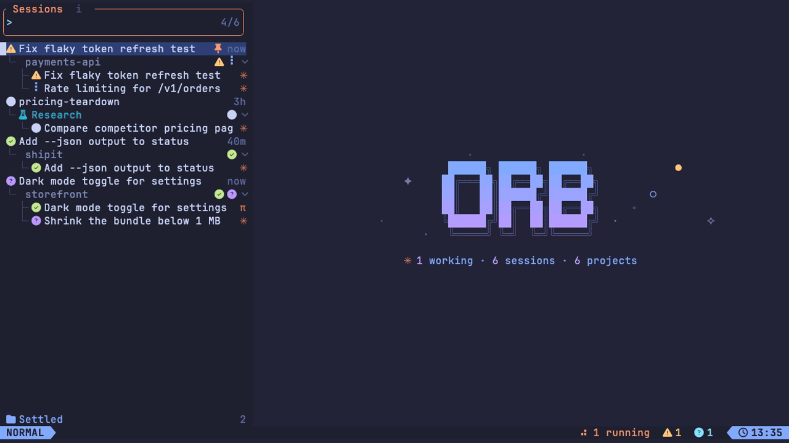

# orb

Run a few coding agents at once and you lose track of which one is working, which one is waiting on you, and which project or worktree each one is in. orb is a terminal multiplexer that shows every Claude Code and pi agent in one sidebar, next to each session's panes.



## Install

macOS or Linux, inside [kitty](https://sw.kovidgoyal.net/kitty/), with [Claude Code](https://claude.com/claude-code) or [pi](https://www.npmjs.com/package/@earendil-works/pi-coding-agent).

```sh
curl -fsSL https://raw.githubusercontent.com/zqccer/orb/main/install.sh | sh
```

This puts orb and [zmx](https://github.com/neurosnap/zmx) (it keeps every pane running) in `~/.local/bin` and sets up orb's Claude Code hook, pi extension and `orb` skill without asking. It asks before it installs kitty and, on macOS, before it adds orb's Cmd keys to kitty.conf. At the end it lists anything left for you. Running it again is safe.

## First run

1. Run `orb` inside kitty.
2. `<C-g> P` opens your projects. `a` adds a folder (`Tab` opens a folder, `⏎` adds it).
3. `<C-g> n` starts a session: pick a project, then its checkout or a new git worktree.
4. Type `claude` or `pi` in the session's shell. The agent shows in the sidebar with its status.
5. Press `<C-g>` to see the keys that can follow. `<C-g> q` quits; the panes keep running and come back next time.

Every key, the mouse, and the macOS key setup: [docs/keys.md](docs/keys.md).

## How AI is used

- **orb is built for AI agents.** The sidebar shows what each Claude Code and pi agent is doing: working, waiting for approval, waiting for input, or done. Agents can also drive orb from the command line. An orchestrator agent in a colony starts its own helper sessions (colonists) with `orb session create`, prompts them and reads their replies.
- **orb was built with Claude Code.** Most features started as a written plan. Claude Code then built each one in phases, ending every phase with the full test suite, a review and a commit.

## Credits

- [herdr](https://github.com/herdrdev/herdr): the multiplexer feel, the control API, the layout code and the sounds. The code and sounds taken from it are listed in [NOTICE](NOTICE).
- [jinn](https://github.com/jayson-lennon/jinn): the look and the architecture.
- [T3 Code](https://github.com/pingdotgg/t3code): the settle sidebar and the worktree flow.
- [zellij](https://zellij.dev): the keys and the layouts.

## Timeline

Started 24 Sep 2026 as a Claude Code session sidebar. Built during Build Fest (from 1 Oct): pi support, tabs, splits and floating panes, transcript search, the mouse, the control API and colonies, sounds, and the installer. See [CHANGELOG.md](CHANGELOG.md).

## License

Apache-2.0. See [LICENSE](LICENSE) and [NOTICE](NOTICE). Working on orb itself? Start with [AGENTS.md](AGENTS.md).
